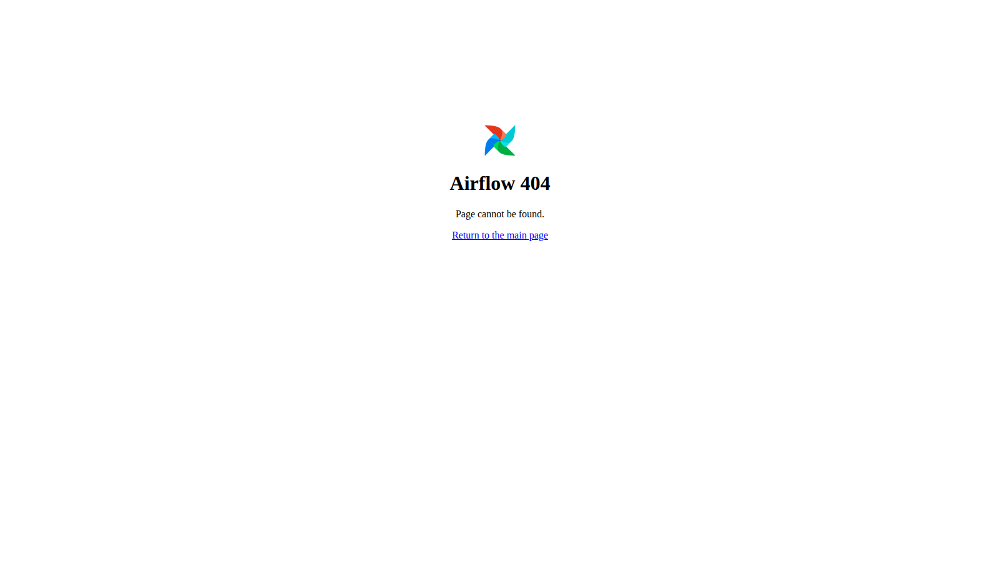
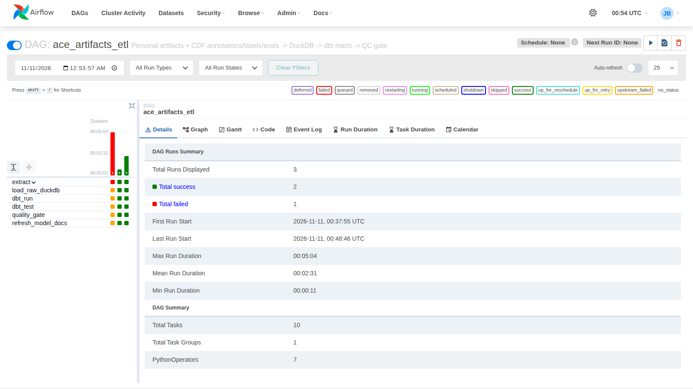
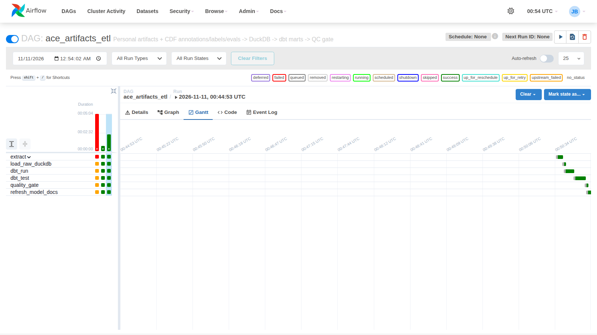

# ACE CDF Media Pipeline — Jai Bhagat

**Repo:** https://github.com/ChaiWithJai/airflow-dbt-project (branch `jai/capstone-cdf-media-pipeline`, PR: https://github.com/ChaiWithJai/airflow-dbt-project/pull/1)

Connects the two data sources behind ACE (Amazing Career Explainers), a tool
that produces educational media from the *How to Organize Your Life with AI*
series, applying the CDF (Customer Desire Framework) label/eval system.

## Data sources (2 formats, 1M+ rows)

| # | Source | Format | Scale |
|---|--------|--------|-------|
| 1 | Personal artifacts: 5 episode VTT transcripts (word-timed), yt-dlp `.info.json` metadata, original Excalidraw whiteboard | VTT + JSON | 19,165 cues / 160,050 word-timed tokens / 230 board elements |
| 2 | Annotations, labels & evals: CDF annotation map (372 x 90s windows, 8-cluster taxonomy, 4,617 board links), provenance blocks, fidelity gates | JSON | 372 windows / 67 provenance blocks / 3 gates |

**1M+ row fact:** `fct_label_events` — every transcript token evaluated against
every CDF cluster label (**1,280,400 rows**), no fabricated data.

## Stack

Airflow 2.10 (10-task DAG: 5 parallel extractors → DuckDB load → dbt run →
dbt test → 10-check quality gate → dbt docs) · DuckDB warehouse · dbt-duckdb
(19 models, 22 tests).

## Data quality (10/10 passing — full details in `quality_check_results.json`)

- Label-event scale ≥ 1M ✅ (1,280,400)
- Cue coverage, timestamp monotonicity, token completeness ✅
- Board-element referential integrity ✅ (4,617 links, 0 orphans)
- Annotation/token-evidence agreement ≥ 60% ✅ (82.2% top-2, 287 evidence windows)
- CDF fidelity gates ✅ (92.48% source-derived ≥ 85%; 7.52% synthetic < 15%; 0% backfill < 10%)

## ETL run (DAG `ace_artifacts_etl`, all 10 tasks success)

## Notes

- The official `airflow-dbt-project` template repo is not publicly available
  in the DataExpert-io org, so the Astro project structure
  (`dags/`, `dbt_project/`, `include/`, `.astro/config.yml`, `Dockerfile`) is
  published under my account with the capstone branch and PR.
- Post-training loop: the repo also runs
  [auto-feedback](https://github.com/DataExpert-io/auto-feedback-example)
  (adapted) — every PR diff is reviewed by an LLM and posted back as a
  structured `trace → label → eval` record.
